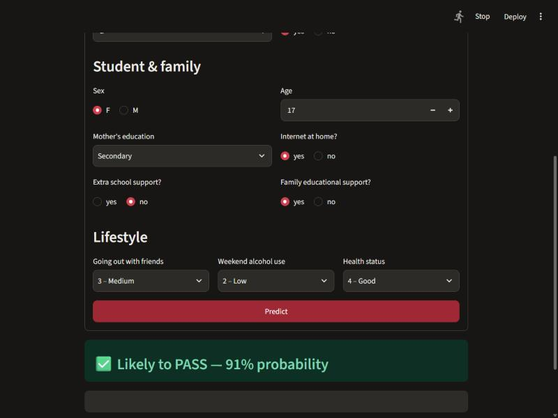
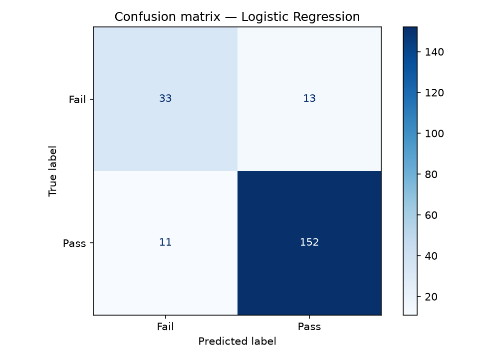
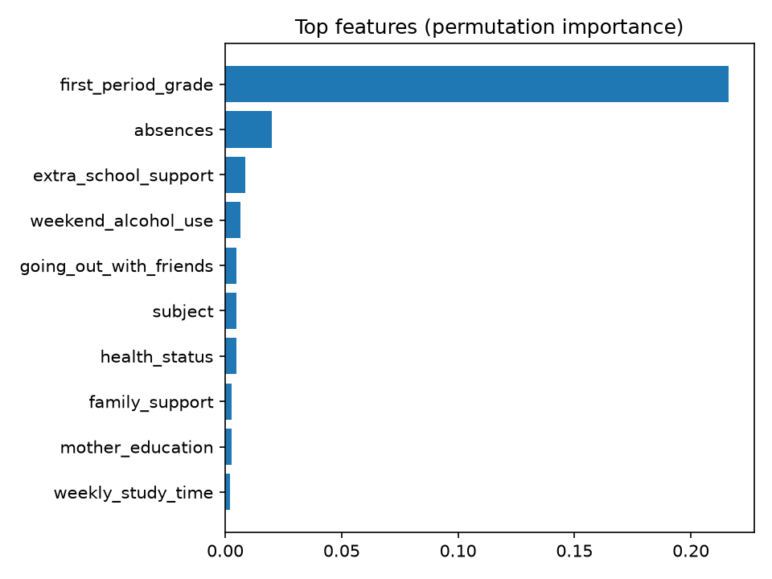

# Student Pass Predictor

Live app: https://pamithu-student-pass-predictor.streamlit.app

A machine learning app that predicts whether a secondary school student will pass the final exam. It only uses information you would already have early in the school year, so the idea is that a teacher could spot students who need help before it's too late.



## Why I made this

In the dataset I used, about 1 in 5 students failed the final exam. Usually that only becomes clear at the end of the year. I wanted to see if a simple model could flag those students early using things like their first grade, absences and study habits.

## Dataset

I used the [Student Performance dataset](https://archive.ics.uci.edu/dataset/320/student+performance) from the UCI Machine Learning Repository. It has 1,044 records from two schools in Portugal (Math and Portuguese classes). I merged both files and added a `subject` column.

- Pass = final grade (G3) of 10 or more out of 20
- 78% pass, 22% fail
- License: CC BY 4.0 (P. Cortez and A. Silva, 2008)

## What I did

I picked 15 features that are easy to understand and known early, for example first period grade (G1), absences, weekly study time, past failures, family support and going out with friends.

I did not use the second period grade (G2). It is very close to the final grade, so the model gets a lot more accurate with it, but it's only known late in the year and that defeats the point.

For preprocessing I used a scikit-learn pipeline (imputing, scaling numbers, one-hot encoding categories), so the app can pass in raw values. Then I compared three models with 5-fold cross-validation on 80% of the data:

| Model | CV ROC-AUC |
|---|---|
| Logistic Regression | 0.943 |
| Random Forest | 0.939 |
| Gradient Boosting | 0.933 |

Logistic Regression did slightly better, so I used it and tested it on the remaining 20% (209 students):

| Metric | Test score |
|---|---|
| Accuracy | 0.885 |
| F1 (macro) | 0.830 |
| ROC-AUC | 0.935 |




The first period grade is by far the most important feature, and absences come second. I was a bit surprised that the simple Logistic Regression beat the tree models.

## Run it yourself

```bash
git clone https://github.com/pamithudulwan892-max/student-grade-predictor.git
cd student-grade-predictor
pip install -r requirements.txt
python train.py
streamlit run app.py
```

`train.py` trains the models and saves the model, metrics and charts. `app.py` is the Streamlit app.

## Limitations

- Small dataset from only two schools, so it might not work the same elsewhere
- Some students are in both the Math and Portuguese files, so the same student can end up in both train and test
- It shows correlation, not cause. This is a learning project and shouldn't be used to make real decisions about students

## Author

Pamithu Dulwan - [GitHub](https://github.com/pamithudulwan892-max) | [LinkedIn](https://www.linkedin.com/in/pamithu-dulwan/)
